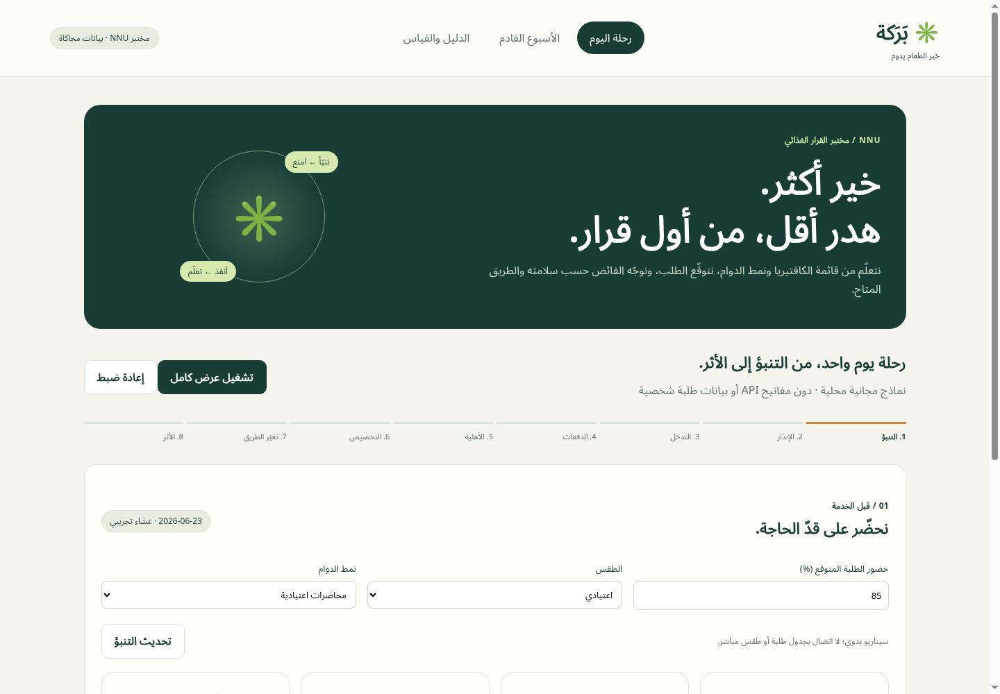
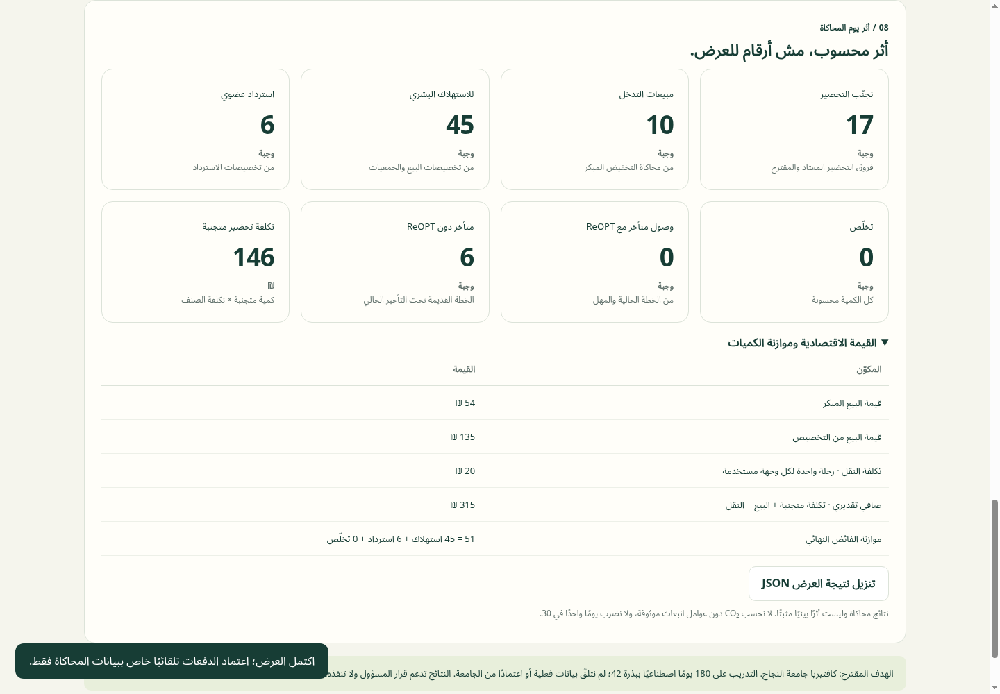

<div align="center">

# ✳ بَرَكة · BARAKA
### خير الطعام يدوم
**Prevention first. A Palestinian cafeteria decision lab.**

Local XGBoost forecasts → early intervention → safety eligibility → CP-SAT allocation → road disruption → dynamic re-optimization → traceable impact.

[Research](docs/research.pdf) · [Architecture & evidence](docs/TECHNICAL.md) · [Telegram setup](docs/TELEGRAM.md)

</div>



BARAKA upgrades the supplied Arabic MVP into a working, local-first ML and optimization application. Its proposed first pilot is an An-Najah National University cafeteria in Nablus. **This is an independent hackathon prototype, not a university partnership or deployed operational system.** All training and demo records are synthetic; no student records are used.

## What works

- **Learn the menu and sales patterns:** 180 days × 2 services × 3 food categories; reproducible seed 42; CSV and SQLite records, chronological lag features, and a category-popularity view.
- **Free, local AI:** two actual CPU XGBoost regressors, without paid APIs or external model credentials. Pre-service demand and intraday final-sales prediction; model artifacts persist with joblib.
- **Campus-aware forecasts:** expected attendance, examinations and rain inputs; seven-day recursive forecasts. These are manual scenarios, not live NNU timetable or weather integrations.
- **Prevention before recovery:** per-dish preparation recommendations, editable remaining-stock entry without POS, an early warning, and a transparent discount-uplift simulation.
- **Real optimization:** Google OR-Tools CP-SAT with strict sequential objectives: maximize human consumption, maximize diversion, minimize fixed destination logistics cost. Every portion is accounted for.
- **Dynamic ReOPT:** +45-minute access delay changes eligibility and recomputes the plan; late-arrival counterfactual is calculated from the actual original allocation.
- **Safety boundaries:** explicit human approval; plate waste and unapproved food cannot use human-consumption routes. Category-selected storage guidance uses a bounded WHO-based rule table, not generated safety claims.
- **Telegram ingress:** authenticated, chat-allowlisted `/delay A MINUTES` reports, freshness checks and operator review before changing a route. Requires configuring your own bot/webhook; no live connection is preconfigured.
- **Honest evidence:** model/baseline MAE and RMSE, interval coverage, greedy allocation baselines, actual generated records, and exportable scenario JSON.
- **Arabic RTL interface:** responsive dashboard, guided manual workflow, one-click full simulation and deterministic reset. SQLite sessions are separated by HttpOnly cookies.

## Run locally

**Requirements:** Python 3.12, approximately 2 GB free disk for Python dependencies, and network access to PyPI during installation. Node.js is only needed for the legacy JavaScript tests; use Node 24. No GPU, Telegram account, Cloudflare account or API key is needed for the core demo.

macOS / Linux:

```bash
./scripts/setup.sh
./scripts/start.sh
```

Windows PowerShell:

```powershell
py -3.12 -m venv .venv
.venv\Scripts\python -m pip install -r backend/requirements.txt
$env:OMP_NUM_THREADS="2"
$env:OPENBLAS_NUM_THREADS="2"
.venv\Scripts\python -m backend.core
.venv\Scripts\python -m uvicorn backend.server:app --host 0.0.0.0 --port 8000
```

Open **http://localhost:8000**. The root opens the new decision lab. API documentation is at `/docs`.

The first setup generates CSV/SQLite data, fits both models and saves metrics under ignored `backend/data/`. Subsequent startups load the artifacts. Delete that generated directory or run `python -m backend.core` to retrain deterministically. Do not load joblib files from untrusted sources.

### Docker alternative

```bash
docker build -t baraka .
docker run --rm -p 8000:8000 baraka
```

The container pretrains models during its build and runs as a non-root user. Docker packaging is supplied; current-session verification used the native Python server. Persist `/app/backend/data` with a writable volume if retaining sessions between container replacements. A newly mounted empty directory trains on first start.

## Three-minute judging walkthrough

1. Open the dashboard and show **التحضير المعتاد / تنبؤ XGBoost / التحضير المقترح**. Expand the per-dish explanation and uncertainty interval.
2. Press **بدء الخدمة**. Show predicted surplus and remaining stock. Optionally change a dish's remaining quantity in **إدخال سريع دون POS**.
3. Press **تطبيق تدخل مبكر**. Show the computed additional sales and final surplus. This uplift is explicitly a simulation, not learned causal evidence.
4. Review the generated batches. Check the **human approval for simulated food** box. Without approval, the optimizer only uses non-human routes.
5. Press **حساب أفضل تخصيص**. Inspect eligibility rejections and the initial plan.
6. Press **محاكاة تأخير +45 دقيقة وإعادة التحسين**. Compare the old/new plans, including portions that would arrive late under the old plan.
7. Show the reconciled impact and its economic components. Export the scenario JSON.
8. Open **الأسبوع القادم**, then **الدليل والقياس** for forecasts, measured errors, allocation baselines, storage guidance and source records.
9. Press **إعادة ضبط** and repeat. **تشغيل عرض كامل** executes the simulated flow with simulated approval automatically; it never approves real food.



## Tests

```bash
.venv/bin/python -m pip install -r backend/requirements-dev.txt
OMP_NUM_THREADS=2 OPENBLAS_NUM_THREADS=2 .venv/bin/python -m unittest discover -s backend/tests -v
npm ci
npm test
npm run check
```

Optional real-browser test (requires Chromium and the server running on port 8081):

```bash
PORT=8081 ./scripts/start.sh
# In another terminal; CHROMIUM can point to your Chromium executable:
npm run test:browser
```

It drives the full and manual workflows, reset determinism, weekly and validation screens, and mobile layout through Chrome DevTools, and updates screenshots. GitHub Actions runs Python pipeline/API tests and the original JavaScript suite; real-browser checks are run separately.

## Publication and deployment

This GitHub repository contains the runnable submission. **A GitHub repository URL does not host the Python application.** Deploy the Dockerfile to a Python/container hosting provider if a public live URL is required; model inference stays local to that server. Production use needs authenticated operators, retention/rate-limit policies, secure HTTPS and verified partner/storage data before exposing it publicly.

The supplied Cloudflare Worker/D1 application is preserved in `src/worker.js` and the old `public/index.html` dashboard. Its `wrangler.jsonc` refers to the original author's Cloudflare resources. **`npm run deploy` only deploys that legacy app; it does not run the new Python ML lab.** No existing published site was changed or verified by this upgrade. Use the Python server or Docker for the new version.

## Limitations that matter

No prediction system can guarantee zero error or zero harm. This prototype supports an accountable operator; it does not approve food, dispatch deliveries, send Telegram messages, take payments or alter real cafeteria production. Storage guidance never overrides measured temperature/time history or local food-safety procedures. Remaining usable times are fixed simulation assumptions, not expiration estimates.

The model learns synthetic patterns, not actual NNU operations. It needs a real cafeteria pilot, timestamped sales/attendance data, prospective evaluation, calibrated uncertainty and verified partners before operational use. The menu has three seeded categories, not unrestricted automatic menu ingestion. Carbon reduction is not estimated, monthly savings are not extrapolated, and organic recovery is not counted as food retained for people.

The research paper supplied with the project is included as background; its claims and third-party comparisons are not independently verified here. See [technical notes](docs/TECHNICAL.md) for the exact implementation and evaluation boundaries.


## مواد تسليم المشروع

- [جرّب تطبيق بَرَكة](https://baraka-vmk6.onrender.com/today.html)
- [العرض على Canva](https://canva.link/kb3txxqjjdykhmm)
- [فيديو المشروع](barakeh_film_final_silent.mp4)
- [البحث العلمي](BARAKA_scientific_research.pdf)
- [عرض بَرَكة PDF](بركة.pdf)
