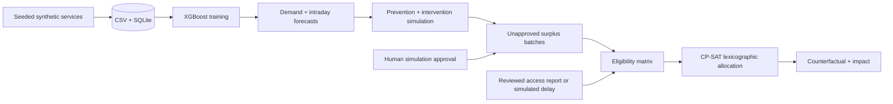

# Architecture and evaluation

`backend/core.py` owns generated records, training, prediction, eligibility, CP-SAT and impact calculations. `backend/server.py` exposes the API, SQLite browser sessions and optional Telegram ingress. `public/today.js` renders API responses; it does not duplicate KPI constants. The supplied legacy application remains separate.

## ML integrity

- 1,080 service/dish records and 3,240 intraday snapshots; six months, deterministic seed 42. Preparation, constrained sales, unmet demand and separate waste streams reconcile.
- Demand is influenced by category, period, attendance, promotions, events, rain, examinations, noise and occasional anomalous demand drops.
- Demand target is latent simulated demand, avoiding the bias from treating stock-constrained sales as unconstrained demand. Actual pilots cannot observe all unmet demand this easily.
- Training dates are the first 126 days, calibration the next 18, and testing the final 36. No date has rows in two splits. Lag means and week-ago values use earlier observations only.
- Historical-average baseline is fitted to the training period by category, service and weekday. Both models are evaluated on the same held-out demand observations.
- Prediction intervals use held-out calibration absolute residuals and a finite-sample 90% quantile. Their reported test coverage is observed, not guaranteed. Anomalies and distribution shifts remain risks.
- Intraday targets are final constrained sales; target columns are excluded from feature matrices. Training uses prior historical average as the available pre-service forecast; testing uses the trained demand forecast. This distribution difference is disclosed in the UI and requires prospective validation.
- Weekly forecasts recursively append predictions to past demand history. Their uncertainty grows with horizon; per-day intervals are not claimed. Synthetic dates are shown rather than relabeled as today's real week.
- The presentation day is selected near the brief's demand/preparation targets from the held-out dinner services. It is a demo example, not evidence of model quality. Accuracy uses the complete held-out set.

## Allocation integrity

Integer portions are split across virtual destinations. CP-SAT solves and fixes each objective's proven optimum before solving the next: human consumption, non-disposal recovery, then fixed logistics expense. Solver results must be `OPTIMAL`; incomplete solves are not shown as proven optimal. One worker and seed 42 keep runs reproducible.

Every batch quantity is assigned exactly once, and destination totals respect both demand and capacity. Human routes require approval, exclude plate waste, require suitable cold transport, and reject arrivals beyond the usable-time or destination-opening limit. Non-human destinations are generic simulated recovery/fallback routes; actual facility acceptance criteria would need verification. The scoped seeded destinations accept all three menu foods; there is no general food-compatibility editor or vehicle routing model.

The model includes first-eligible and closest-first greedy baselines under identical eligibility/capacity constraints. It does not assume the optimizer always improves human recovery; cost or outcome ties are legitimate. Allocation explanations show eligibility; they are not causal proofs of each route's global optimality.

The counterfactual applies the new delay to the original plan's human routes. The comparison is between continuing the old plan and replacing the full plan before dispatch. It does not model already-delivered or in-transit food, elapsed wall time, multi-stop vehicles, or live traffic.

## Economics and safety

Intervention sales are a capped 16% uplift simulation, not a trained causal response. The predicted final surplus drives batches, so intervention results are simulated expected outcomes, not observed closing inventory. Avoided preparation value uses the sum of per-dish positive preparation reductions times unit cost. Early sales and after-closing discounted allocations are separate quantities. Logistics is charged once per used destination. The net figure is labeled estimated and excludes labor and other unmodeled operating costs.

Storage guidance is selected by food category from general WHO Five Keys principles: https://www.who.int/publications/i/item/9789241594639 . It is not a free-form generative model or food-safety certification. Mixed bread/salad needs separation and salad refrigeration. Staff must measure temperatures and follow locally approved procedures. Unknown food or unobserved handling cannot be declared safe by the model.

## Deployment boundaries

SQLite is sufficient for a single-process hackathon demo; application mutations use a process-local lock. This is not a multi-worker or multi-institution production architecture. Session records persist locally and are not tied to authenticated identities; reset clears the current scenario. Public hosting needs additional authorization and abuse controls. Optional Telegram is an ingress integration and was validated with synthetic signed updates only.

Model artifacts, generated databases and credentials are ignored by Git. First startup or the setup script generates the reproducible data and models. The local CPU model is free to run; Python/package downloads and a public hosting provider may have their own resource costs. The repository makes no deployment or competition-placement guarantee.
